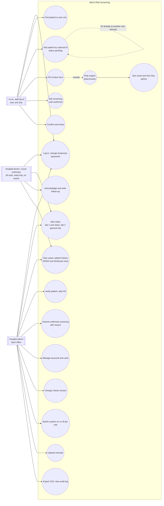
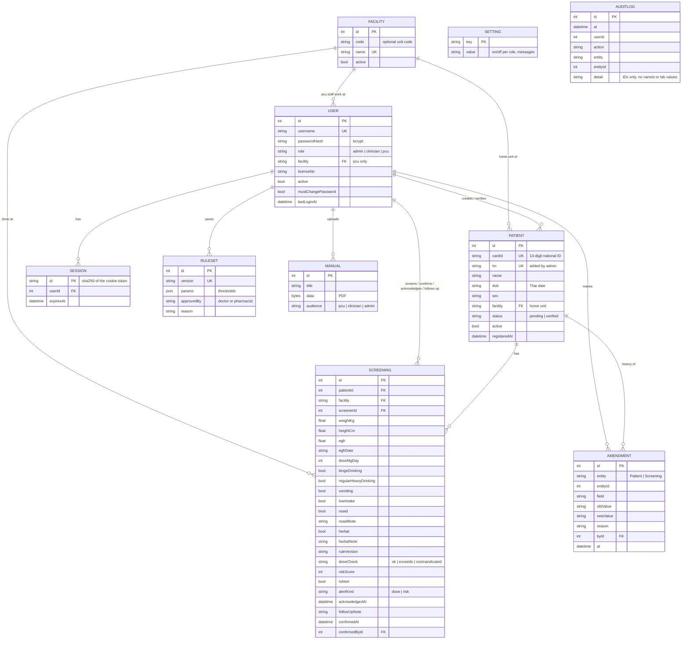
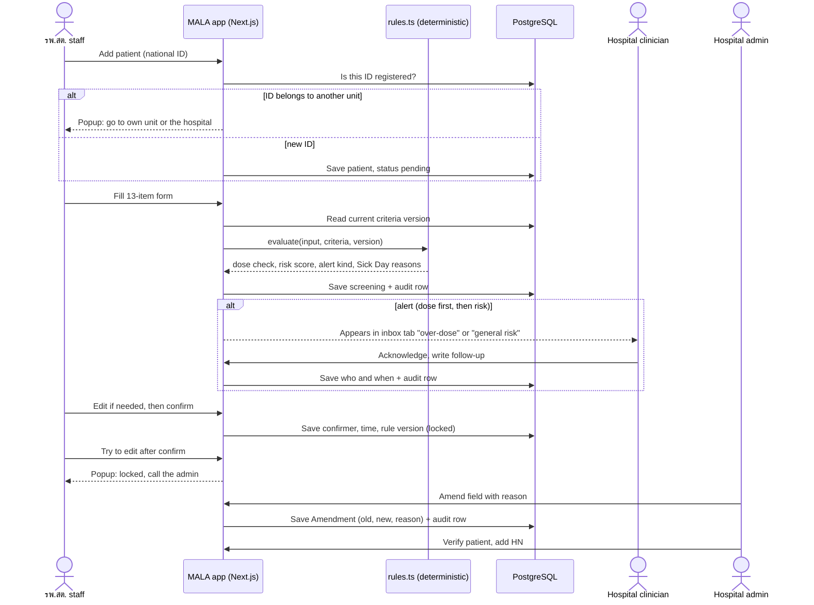
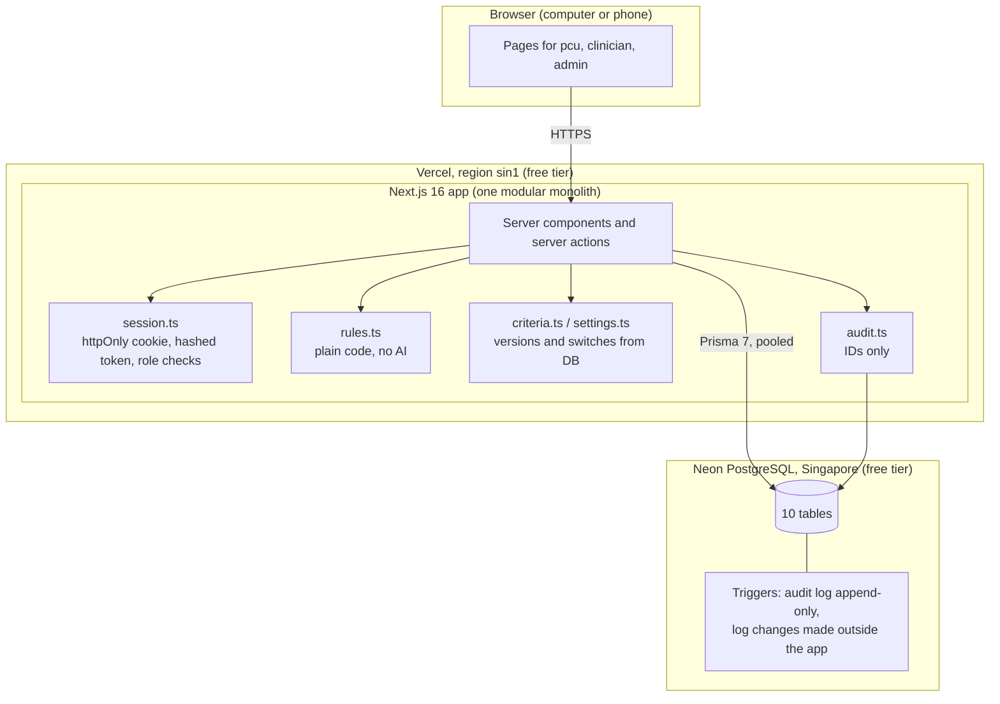

# Diagrams: MALA Risk Screening

**v4, 18 Nov 2026.** Redrawn from the v2 code (`app/prisma/schema.prisma`, `app/src/`) after the
hospital session on 17 Nov 2026 (`test/sessions/S01-2026-11-17-hospital-uat.md`).

> **What changed from v3 (8 Sep 2026):** three roles instead of one staff role; patients keyed by
> national ID with admin verification; screenings locked after confirmation with an amendment
> history; criteria stored as versions the admin can change; two alert kinds; the AI advice box
> and the LINE channel are removed because they were not built. v3 is in the git history
> (commit `fe4451b`). The draw.io file `mala-diagrams.drawio` still shows v3.

## 1. Use-case diagram

## 2. ER diagram

Ten tables. Every write is also recorded in `AuditLog` (not drawn as a relation; it keeps IDs only).

## 3. Sequence diagram: screen, alert, lock

## 4. Architecture diagram

The same app runs on the hospital's own server with any PostgreSQL (see
`../final/deployment.md`). Not shown because not built: LINE alerts, AI advice, chatbot,
HIS / HOSxP link.
